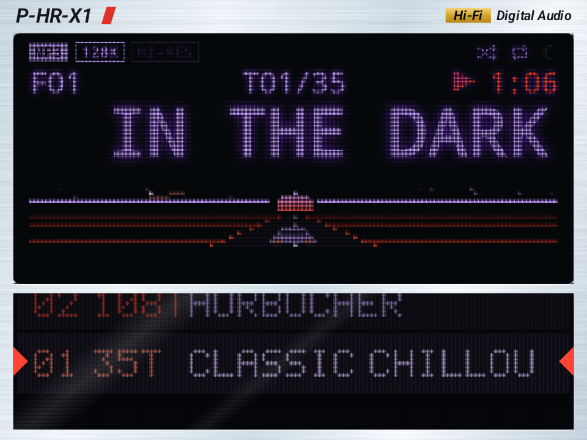
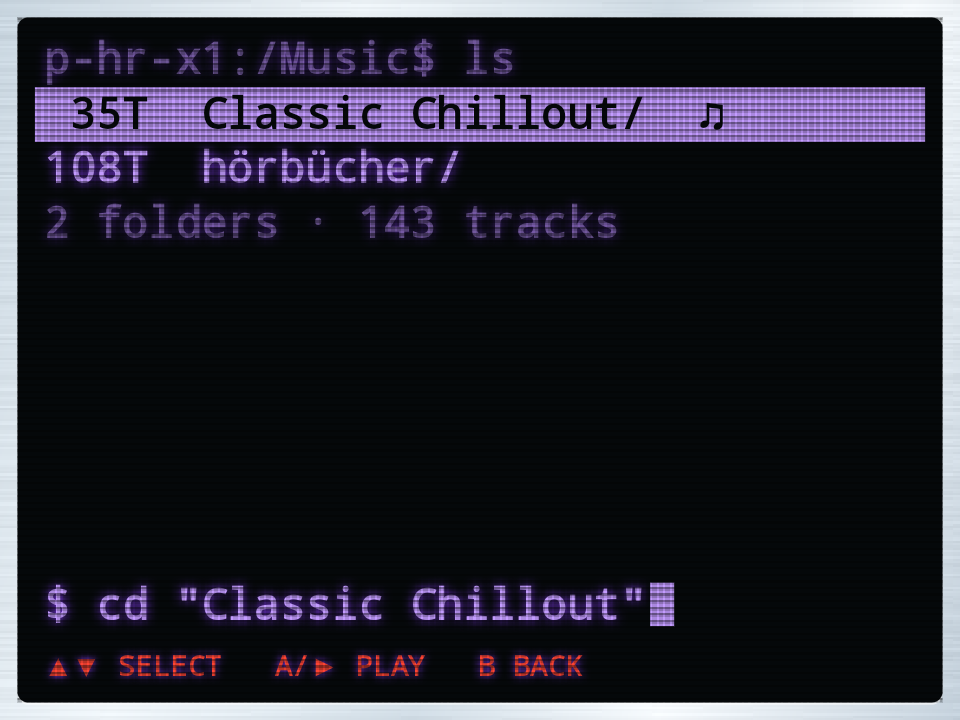
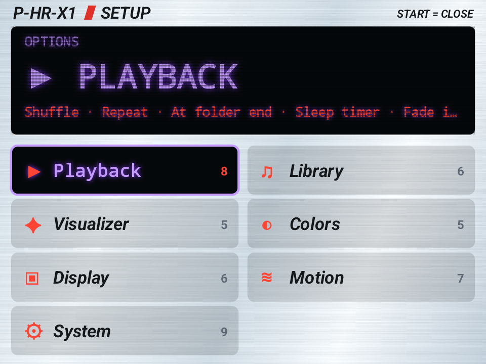
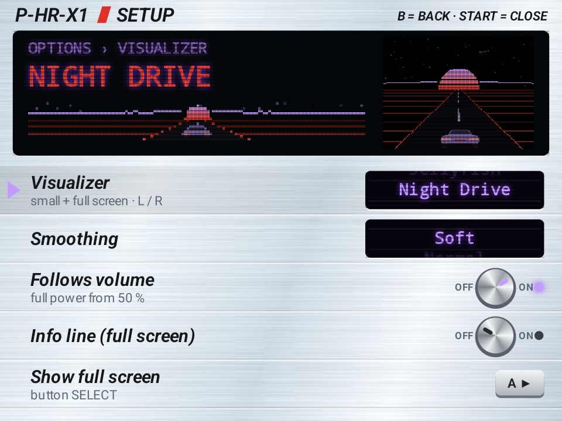
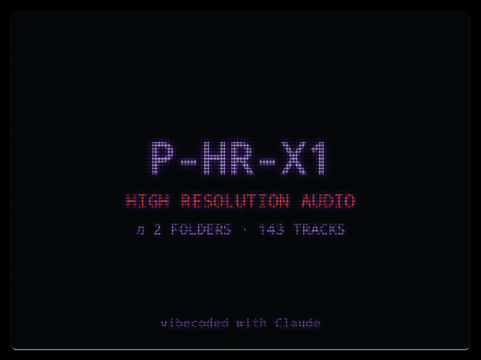

# P-HR-X1

Music player in 2000s hi-fi style for Android gamepad handhelds.

*vibecoded with Claude* · [Download the APK](https://github.com/velo-sys/P-HR-X1/releases/latest)

## Screens

| Main screen | Folder list (B) |
|---|---|
|  |  |
| VFD display, small visualizer and the folder drum | Bash-style list: track count and folder name |

| Setup (START) | Visualizer setup |
|---|---|
|  |  |
| Seven categories, the display shows the selection | Live preview of the small and the full-screen visualizer |

| Full-screen visualizer (SELECT) | Boot animation |
|---|---|
|  |  |
| Night Drive, one of 24 visualizers | VFD test on start |

All screenshots: color scheme Lavender / Red, brightness 100 %.

**Interactive preview:** open [`docs/index.html`](docs/index.html) in a browser.

## Features

- **Folders are playlists** on a pixel-art drum (▲▼); add any folder through a bash-style browser
- **Bash-style folder list** (B)
- **VFD display** with format, bit depth, sample rate or bitrate and pixel status icons
- **24 visualizers** driven by the real audio signal, small and full screen in sync (L / R, SELECT), intensity follows the volume
- **Two-color schemes**: main and second color in shades, 25 colors, rainbow mode, presets, swap on beat
- **Setup window** with its own display and live previews
- **Formats**: MP3, FLAC, WAV, M4A/AAC, OGG and Opus; all audio files are always found
- English and German, touch control, background playback, sleep timer, fade in/out, about screen with device info
- No internet permission, no ads, no tracking, about 1.2 MB

## Controls

| Button | Action |
|---|---|
| A | Play / pause |
| ◀ ▶ | Previous / next track · hold = seek |
| ▲ ▼ | Previous / next folder |
| B | Folder list |
| START | Setup |
| SELECT | Full-screen visualizer |
| L / R | Switch visualizer |
| X / Y | Shuffle / repeat |
| VOL ± | Volume |

## Setup menu

| Category | Options |
|---|---|
| Playback | Shuffle · Repeat · At folder end · Sleep timer · Fade in/out · Gapless · Autoplay on start · Pause on unplug |
| Library | Music folder · Add folder · Subfolders separate · Track order · Hidden folders · Rescan |
| Visualizer | Visualizer · Smoothing · Follows volume · Info line (full screen) · Show full screen |
| Colors | Color scheme · Main color · Second color · Two-tone style · Peak color |
| Display | Brightness · Glow · Scanlines · Flicker · Format display · Keep screen on |
| Motion | Marquee shows · Marquee style · Marquee speed · Drum · Window transition · Boot animation · Show boot animation |
| System | Language · Touch control · Swap A/B · Volume display · Button map · Button test · About · Factory reset · Quit |

## Requirements

Android 8.0 or newer, designed for 4:3 screens (960×720). Grant "Music and audio" access on first start.

## Build

```sh
./build.sh            # APK: P-HR-X1.apk
```

`build.sh` runs Gradle 8.10 / JDK 17 in a podman container and expects the Android SDK in `../.android-sdk` (override with `ANDROID_SDK`). For your own signing key create `keystore.properties` with `storeFile`, `storePassword`, `keyAlias` and `keyPassword`; without it the debug key is used.

## Project layout

| File | Purpose |
|---|---|
| `Engine.kt` | Playback (Media3/ExoPlayer), folder queue, format detection |
| `Analyzer.kt` | FFT, bands, waveform, levels and beat detection from the PCM stream |
| `Library.kt` | MediaStore scan and folder tree |
| `DeckView.kt` | User interface and input |
| `Viz.kt` · `Drum.kt` · `Pix.kt` | Visualizers, folder drum, pixel buffer and font |
| `Opts.kt` · `SysInfo.kt` · `Icons.kt` | Options, colors and texts, device info, icons |

## Legal

P-HR-X1 is an independent project and not affiliated with any device manufacturer. Product names belong to their respective owners.

The Android robot is reproduced or modified from work created and shared by Google and used according to terms described in the Creative Commons 3.0 Attribution License.
